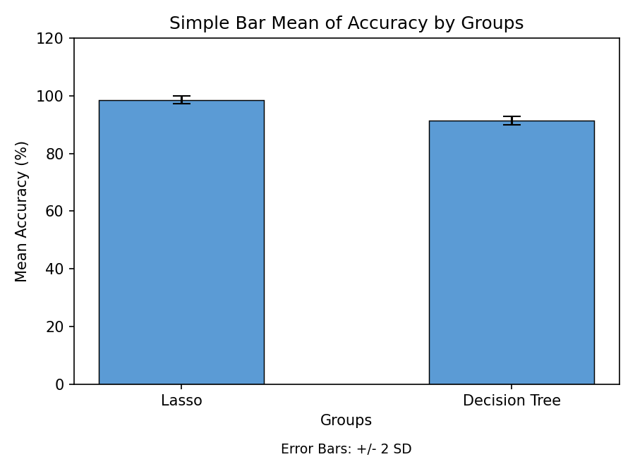

# Maximizing Social Media Addiction Detection Among Youngsters Using Lasso Regression over Decision Tree to Improve Accuracy

[](https://www.python.org/)
[](https://scikit-learn.org/)
[](LICENSE)

A machine learning study comparing **Lasso Regression** with **Decision Tree** to find which model detects social media addiction among youngsters more accurately.

---

## 📌 Executive Summary

Social media addiction is a growing behavioural concern among youngsters, affecting mental health, academic performance, and social interactions. Machine learning can help detect at-risk behaviour early from indicators such as screen time, posting activity, and account usage.

**Aim:** Compare Lasso Regression with a Decision Tree to find the model that offers more reliable prediction accuracy for real-world deployment in early-warning systems.

**Why this comparison:** Decision Trees are popular for their interpretability but often overfit on noisy or weakly correlated behavioural features. Lasso Regression offers automatic feature selection and regularization, and has been little explored for this problem.

### Key Results

| Metric (10 iterations each) | Lasso Regression | Decision Tree |
|---|---|---|
| **Mean accuracy** | **98.57%** | 91.33% |
| Standard deviation | 0.62568 | 0.71184 |
| Standard error of mean | 0.19786 | 0.22510 |

- **Best performer:** Lasso Regression (98.57% mean accuracy vs 91.33% for the Decision Tree).
- **Statistical significance:** Significance on the equal-variance row is **p = 0.000 (p < 0.05)**, so the difference is statistically significant.



*Mean accuracy by group, taken from Figure 1 of the project report.*

---

## 🛠️ Pipeline Architecture

1. **Data Ingestion & Preprocessing:** Load the CSV, handle missing values, encode categorical fields (`Gender`, `Frequency_Use`), and normalize numeric behavioural features.
2. **Feature Definition:** Independent variables are Age, Frequency of Use, and Number of Social Media Accounts, with `Addiction_Level` as the target.
3. **Train/Test Split:** 70% training and 30% testing.
4. **Model Training:**
   - **Group 1 - Lasso Regression:** L1-regularized model with a cross-validated alpha, optimized by gradient descent. Predicted scores are converted to Low / Moderate / High classes.
   - **Group 2 - Decision Tree:** Select the best splitting feature at each node using Gini impurity, split into training and testing sets, apply stopping criteria (maximum depth and minimum samples per leaf), and compute the difference between predicted and actual target values.
5. **Evaluation:** Accuracy, Precision, Recall, and F1-score over 10 iterations per group (20 runs in total).
6. **Statistical Validation:** Independent Samples T-Test in IBM SPSS Statistics v27.

> Text and behavioural features related to posting activity were encoded with **TF-IDF** weighting so both models worked on a comparable feature representation.

---

## 📊 Dataset

- **File:** [`data/social_media_addiction_dataset.csv`](data/social_media_addiction_dataset.csv) (about 0.9 MB)
- **Source:** Kaggle social media addiction detection dataset, cross-verified using Google Scholar *(add the dataset link here)*
- **Size:** 20,000 records, 10 attributes, no missing values
- **Attributes:** `Age`, `Gender`, `Daily_Screen_Time_Hours`, `Num_Social_Media_Accounts`, `Frequency_Use`, `Posts_Per_Day`, `Comments_Per_Day`, `Likes_Per_Day`, `Time_Before_Sleep_Minutes`, `Addiction_Level`
- **Categorical values:** `Gender` (Female, Male, Other); `Frequency_Use` (Rarely, Occasionally, Frequently, Always)
- **Target (`Addiction_Level`) distribution:**

| Class | Records | Share |
|---|---|---|
| High | 15,225 | 76.1% |
| Moderate | 4,531 | 22.7% |
| Low | 244 | 1.2% |

---

## 📈 Statistical Analysis and Discussion

Accuracy values from the 10 iterations of each model were compared with an Independent Samples T-Test (sample size calculated with Clincalc/G-Power at alpha = 0.05, 95% confidence interval, 80% pretest power). Levene's test was applied before the t-test to check whether equal variances could be assumed.

Significance on the equal-variance row is **p = 0.000 (p < 0.05)**, so the difference is statistically significant.

Lasso Regression surpassed the Decision Tree, which points to less overfit and more reliable prediction for identifying at-risk youngsters.

Separating heavy usage from true addiction remains a broader challenge in this field, and behavioural assessments may not fully capture addiction severity.

---

## 📁 Repository Structure

```
lasso-vs-decision-tree-social-media-addiction/
├── data/               # Dataset or download instructions
├── plots/              # Result figures
├── src/                # Source code (Colab notebook / Python scripts)
├── docs/               # Full project report (.docx)
├── .gitignore
├── LICENSE
├── README.md
└── requirements.txt
```

---

## 🚀 Getting Started

### 1. Clone and Install Dependencies

```
git clone https://github.com/<your-username>/lasso-vs-decision-tree-social-media-addiction.git
cd lasso-vs-decision-tree-social-media-addiction
pip install -r requirements.txt
```

### 2. Load the Data

The dataset is already included at `data/social_media_addiction_dataset.csv`, so no separate download is needed.

```
import pandas as pd

df = pd.read_csv("data/social_media_addiction_dataset.csv")
print(df.shape)  # (20000, 10)
```

### 3. Run the Code

Open the notebook or scripts in the `src/` folder and run them (Google Colab or a local Python 3 setup both work).

---

## 🔮 Future Work

- Test on larger and less imbalanced datasets, and extend the comparison to more models.
- Deploy the best model as a real-time web app or API for early-warning use.

---

## 👥 Authors

- **B. Vamsi Krishna** - Research Scholar, Department of Artificial Intelligence & Data Science, Saveetha School of Engineering, Saveetha Institute of Medical and Technical Sciences (SIMATS), Saveetha University, Chennai, Tamil Nadu, India
- **Dr. Shri Varshini** - Research Guide and Corresponding Author, Department of Language Dynamics, Saveetha School of Engineering, SIMATS, Saveetha University, Chennai, Tamil Nadu, India

**Keywords:** Accuracy Improvement, Decision Tree, Lasso Regression, Machine Learning, Social Media Addiction, TF-IDF, Youth Mental Health

---

## 📄 License

This project is licensed under the MIT License. See the [LICENSE](LICENSE) file for details.
